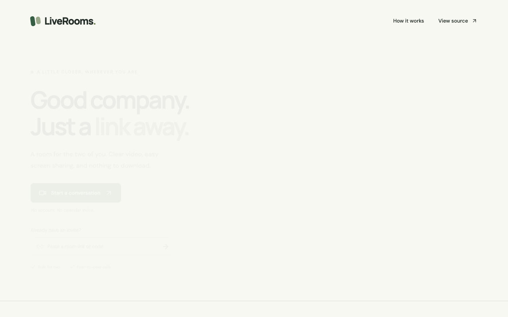
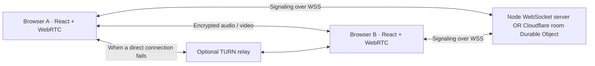

# LiveRooms

A small, thoughtful space for two people to connect. Create a room, check your devices, and send a link. No account or download required.



Explore the [pre-call lobby](docs/screenshots/lobby.png), [call workspace](docs/screenshots/room.png), and [mobile layout](docs/screenshots/room-mobile.png).

## What it does

- Two-person WebRTC audio/video calls, with a pre-call camera preview and device selection.
- Screen sharing that restores the original camera when stopped, including the browser’s native stop button.
- Camera and microphone toggles, receive-only joining, invitation links, and participant media status.
- Automatic signaling reconnection, ICE restart, explicit room capacity errors, and replacement peers without a page reload.
- Live connection details: direct/relayed media, round-trip latency, and TURN availability.
- Responsive layouts, labeled controls, reduced-motion support, and clear permission/error recovery.

## Run locally

Use **Node.js 22.12+** and **pnpm 10.25.0**.

```sh
corepack enable
pnpm install --frozen-lockfile
pnpm dev
```

Open **http://localhost:5173**. The local signaling service listens on **http://localhost:3001**. Open the same room in two browser windows to try a call. Localhost is a secure context; hosted camera/microphone access requires HTTPS.

Optional configuration:

```sh
cp frontend/.env.example frontend/.env
cp server/.env.example server/.env
```

The frontend reads `VITE_SIGNALLING_SERVER_URL` at build time. Production builds require an explicit URL; an unset URL produces a helpful configuration error instead of connecting to a stale deployment.

To use the local Cloudflare runtime:

```sh
pnpm --filter worker dev
```

Set `VITE_SIGNALLING_SERVER_URL=http://localhost:8787` in `frontend/.env`, then restart Vite. This uses local Durable Objects and creates no remote resources.

## Architecture



The frontend is a Vite/React application. `useMedia` owns device tracks and their cleanup; `useCall` owns the peer connection, signaling, session generations, and recovery. Fixed audio/video transceivers allow device and screen-track replacement without adding negotiation races.

The adapters in `server/` and `worker/` use the same validated protocol and room lifecycle from `shared/`. One participant initiates negotiation. Each pair receives a fresh session ID, preventing delayed candidates or descriptions from a previous peer from corrupting the new call.

Cloudflare uses **one SQLite-backed Durable Object per room**, WebSocket hibernation, and serializable socket attachments for membership/session/rate state. No application database is required. The Node adapter stores room membership in memory and is intended for a single instance.

Media travels directly between peers whenever possible; the signaling service does not forward or record it. TURN relays encrypted media when NAT/firewall rules prevent direct connections. This is a link-based guest application: anyone holding a room link can occupy an available seat. It does not implement authenticated identities or a host waiting room.

## Verify

```sh
pnpm check                         # lint, builds, all TypeScript checks, unit tests
pnpm exec playwright install chromium
pnpm test:e2e                      # browser flows + real sockets against Node and workerd
pnpm --filter worker dry-run       # packaging/binding validation; does not deploy
pnpm audit --prod
```

Browser tests use synthetic cameras/microphones and cover actual peer connections, remote playback, media toggles, device cleanup, peer replacement, permission denial, and mobile layout. Network tests exercise both signaling implementations for isolation, capacity, negotiation, departure, and replacement. CI runs these checks for pull requests and pushes to `main`, retaining browser traces on failure.

See [deployment preparation](docs/DEPLOYMENT.md) for Vercel, Cloudflare, and Cloud Run. Deployment is deliberately separate from CI.

## Project layout

| Directory   | Purpose                                                                    |
| ----------- | -------------------------------------------------------------------------- |
| `frontend/` | React UI, device lifecycle, WebRTC session controller                      |
| `shared/`   | Zod-validated message protocol, room lifecycle, TURN credential generation |
| `server/`   | Portable Node.js WebSocket adapter                                         |
| `worker/`   | Cloudflare Worker and room Durable Object                                  |
| `tests/`    | Protocol unit tests, browser and signaling integration tests               |
| `docker/`   | Optional frontend and Node server containers                               |

## Current scope

Designed for **two participants**. There is no recording, persistent chat, billing, or account system. Group calls would need a separate media architecture, typically an SFU.

TURN requires server-side credentials and incurs relay bandwidth usage. Without TURN, restrictive networks may fail to connect; room details explicitly show whether a relay is configured. Automated tests validate local synthetic media, not real devices across every browser and network. Before production, verify actual camera/mic/screen sharing on Chrome, Firefox, Safari, and a restrictive/mobile network.
